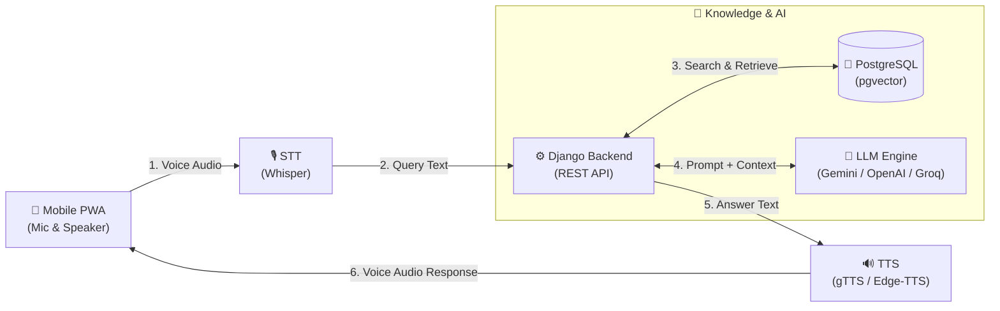
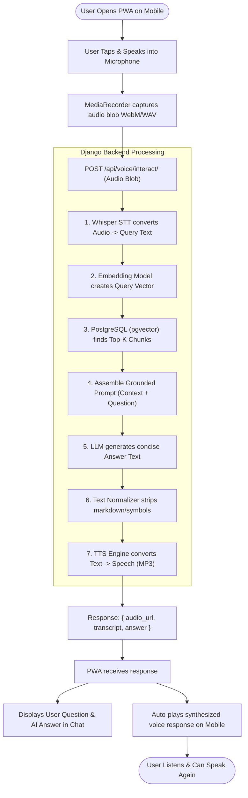
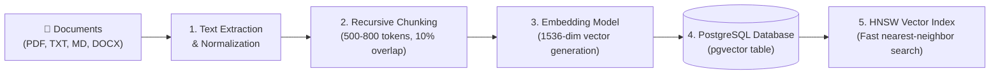

# 🎙️ Mobile AI Voice Assistant (RAG + Django + PostgreSQL)

An intelligent, low-latency AI Voice Assistant accessible on mobile devices via a responsive Progressive Web App (PWA). The system integrates **Speech-to-Text (STT)**, **Retrieval-Augmented Generation (RAG)** over a custom knowledge base, and **Text-to-Speech (TTS)** powered by **Django** and **PostgreSQL (pgvector)**, designed for cloud hosting on a custom domain.

---

## 📐 Simple Architecture

### High-Level System Flow



### How It Works (In 4 Simple Steps)

1. **Voice Input (STT)**: You speak into your mobile browser. The microphone records audio and sends it to the STT engine (Whisper) to convert into text.
2. **Context Retrieval (RAG)**: The Django backend converts the question into a vector and finds the most relevant knowledge documents in **PostgreSQL (`pgvector`)**.
3. **AI Generation (LLM)**: The retrieved knowledge and question are sent to the LLM to generate an accurate, grounded response.
4. **Voice Output (TTS)**: The text answer is converted into audio using **TTS (gTTS / Edge-TTS)** and played back instantly on your mobile phone.

---

## 🔄 System Workflows

### 1. User Voice Interaction Workflow (Runtime Flow)

This workflow outlines the continuous loop when a user interacts with the voice assistant on mobile:



---

### 2. Knowledge Ingestion Workflow (Admin / Setup Flow)

This workflow is executed when documents or knowledge are added or updated in the RAG pipeline:



---

## 🛠️ Technology Stack

| Component | Selected Technology | Purpose & Rationale |
|---|---|---|
| **Mobile Frontend** | **PWA (HTML5, Vanilla CSS, JS)** | Native app feel on iOS/Android without app stores; access to Web Audio & MediaRecorder APIs. |
| **Backend Framework** | **Django + Django REST Framework** | Robust API architecture, built-in ORM, secure authentication, and administrative controls. |
| **Database & Vector Store** | **PostgreSQL + `pgvector`** | Unified database storing relational app data (users, sessions) and vector embeddings (HNSW/IVFFlat). |
| **Speech-to-Text (STT)** | **OpenAI Whisper / Groq Whisper / Web Speech** | Accurate multi-accent mobile voice transcription. |
| **RAG & Orchestration** | **LangChain / LlamaIndex + HuggingFace/OpenAI Embeddings** | Document chunking, vector indexing, similarity search, and prompt augmentation. |
| **Text-to-Speech (TTS)** | **gTTS (Google TTS) / Edge-TTS** | Free, natural speech synthesis; Edge-TTS offers low-latency streaming options. |
| **Production & DevOps** | **Docker, Nginx, Gunicorn, Cloudflare / Certbot** | Containerized deployment, reverse proxy, custom domain DNS, and automatic SSL. |

---

## 🗺️ Phased Action Plan & Implementation Roadmap

### Phase 1: Environment & Database Setup
- [ ] Initialize Python virtual environment (`python -m venv venv`) and Git repository.
- [ ] Install core dependencies:
  - `django`, `djangorestframework`, `django-cors-headers`
  - `psycopg2-binary`, `pgvector`
  - `python-dotenv`
- [ ] Configure PostgreSQL with the `pgvector` extension:
  ```sql
  CREATE EXTENSION IF NOT EXISTS vector;
  ```
- [ ] Design Django Database Models:
  - **`KnowledgeDocument`**: Document title, source file/URL, raw content, upload date.
  - **`DocumentChunk`**: Foreign key to document, chunk content, token count, vector embedding field (`VectorField(dimensions=...)`).
  - **`ChatSession` & `ChatMessage`**: Session ID, user audio input path, transcribed text, AI response, generated audio path, latency metrics.

---

### Phase 2: RAG Pipeline & Vector Search
- [ ] **Document Ingestion Engine**:
  - Support PDF, TXT, DOCX, and Markdown parsing.
  - Implement recursive character chunking (e.g. 500–800 tokens with 10% overlap).
- [ ] **Embedding Generation**:
  - Connect embedding model (e.g. `text-embedding-3-small` or local HuggingFace sentence-transformers).
  - Bulk compute and store vector embeddings into PostgreSQL.
- [ ] **Vector Indexing & Retrieval**:
  - Create HNSW or IVFFlat index on the vector column for sub-second search times.
  - Implement top-$k$ semantic search with cosine or L2 similarity.
- [ ] **Context Injection & LLM Synthesis**:
  - Engineer system prompts with strict grounding rules to eliminate hallucinations.
  - Integrate LLM API (Google Gemini, OpenAI, or Groq for ultra-fast generation).

---

### Phase 3: Voice Processing Pipeline (STT & TTS)
- [ ] **Speech-to-Text (STT) Service**:
  - Setup Django endpoint to receive audio blobs (`multipart/form-data`).
  - Transcribe audio using Whisper API (Groq/OpenAI) or local `faster-whisper`.
- [ ] **Text-to-Speech (TTS) Service**:
  - Clean LLM output (strip markdown formatting, asterisks, URLs, and emojis for natural speech).
  - Synthesize voice using `gTTS` or `edge-tts`.
  - Save audio to media storage or stream directly to the client.
- [ ] **Unified Voice Chat Endpoint**:
  - `POST /api/voice/interact/`: Takes user audio $\rightarrow$ STT $\rightarrow$ RAG query $\rightarrow$ LLM generation $\rightarrow$ TTS $\rightarrow$ returns JSON with audio URL + transcription + answer text.

---

### Phase 4: Mobile-First Frontend (PWA)
- [ ] **Mobile-Optimized Interface**:
  - Fluid, responsive dark-mode layout designed for one-handed mobile use.
  - Pulsing voice visualizer / wave animation during speech input and playback.
  - Push-to-talk (PTT) and tap-to-record toggle modes.
- [ ] **Audio Capture & Compatibility**:
  - Implement `MediaRecorder` API with fallback codecs (`audio/webm`, `audio/mp4`, `audio/wav`).
  - Resolve iOS Safari autoplay restrictions via initial user-gesture audio context unlock.
- [ ] **PWA Configuration**:
  - Add `manifest.json` with app icons, theme colors, and standalone display mode.
  - Setup lightweight service worker for asset caching and offline shell.

---

### Phase 5: Latency & Performance Optimization
- [ ] **Latency Benchmarking**: Keep round-trip time under 2.5 seconds.
  - Leverage Groq or Gemini 2.0 Flash for sub-second LLM inference.
  - Stream TTS audio chunks if real-time playback is needed.
- [ ] **Caching**:
  - Add Redis caching for repetitive queries and static document embeddings.
- [ ] **Audio Compression**:
  - Compress audio recordings on the client-side before transmission to minimize network payload.

---

### Phase 6: Domain Setup, Production Hosting & Security
- [ ] **Containerization**:
  - Create `Dockerfile` and `docker-compose.yml` for Django, PostgreSQL with pgvector, and Nginx.
- [ ] **Server Deployment**:
  - Deploy to an Ubuntu VPS (DigitalOcean Droplet, Hetzner, AWS EC2, or Render).
  - Configure Gunicorn/Uvicorn as WSGI/ASGI application server.
  - Configure Nginx reverse proxy with static/media file caching.
- [ ] **Domain & SSL Setup**:
  - Buy custom domain (Cloudflare, Namecheap, Porkbun, etc.).
  - Configure DNS `A` records pointing to your server's public IP address.
  - Obtain and auto-renew free SSL certificate via Let's Encrypt / Certbot:
    ```bash
    sudo certbot --nginx -d yourdomain.com -d www.yourdomain.com
    ```
    *(Note: HTTPS is **mandatory** for browsers to permit mobile microphone access).*
- [ ] **Security Hardening**:
  - Set `DEBUG = False`, configure `ALLOWED_HOSTS` and CORS origins.
  - Store API keys and database credentials in `.env`.
  - Add API rate limiting via Django REST framework throttling.

---

## ⚠️ Key Technical Considerations & Gotchas

1. **HTTPS Is Mandatory for Microphones**: Mobile browsers (iOS Safari, Android Chrome) strictly block microphone access on insecure HTTP connections (except `localhost`). HTTPS on your custom domain is non-negotiable.
2. **iOS Safari Audio Autoplay**: Mobile Safari blocks programmatic `.play()` calls unless an initial audio interaction occurs via a direct user tap. Initialize the `AudioContext` on the first user interaction.
3. **TTS Text Pre-processing**: Raw markdown (like `**bold**`, `## headers`, or bullet points) sounds unnatural when read by TTS engines. Strip all markdown formatting prior to TTS conversion.
4. **gTTS vs. Edge-TTS**:
   - `gTTS` is stable and free, but saves complete MP3 files and has noticeable network round-trip time.
   - `edge-tts` provides asynchronous streaming and significantly more natural voices.

---

## 🚀 Getting Started (Initial Local Setup)

### 1. Clone & Set Up Virtual Environment
```bash
python -m venv venv
# Windows:
venv\Scripts\activate
# Linux/Mac:
source venv/bin/activate
```

### 2. Install Core Packages
```bash
pip install django djangorestframework django-cors-headers psycopg2-binary pgvector gTTS edge-tts openai python-dotenv
```

### 3. Create Django Project
```bash
django-admin startproject voice_assistant_backend .
python manage.py startapp assistant
```
